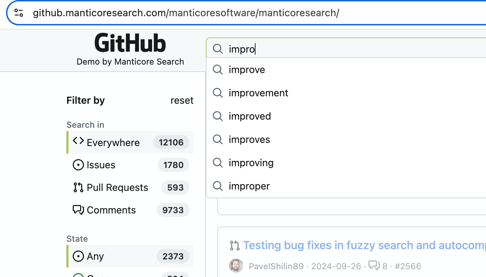

<p align="center">
  <a href="https://manticoresearch.com" target="_blank" rel="noopener">
    
  </a>
</p>

<h3 align="center"><strong>Open-source database for search: full-text, vector, hybrid and conversational</strong></h3>
<p align="center">
Find words, meanings and answers, even with typos, in one fast database you run on your own servers.<br>
Query it with SQL over the MySQL protocol or with JSON over HTTP. A lightweight alternative to Elasticsearch.
</p>

<p align="center">
<a href="LICENSE"></a>
<a href="https://github.com/manticoresoftware/manticoresearch/releases/latest"></a>
<a href="https://github.com/manticoresoftware/manticoresearch/actions/workflows/test.yml?query=branch%3Amain"></a>
<a href="https://hub.docker.com/r/manticoresearch/manticore"></a>
<a href="https://github.com/manticoresoftware/manticoresearch/graphs/commit-activity"></a>
<a href="http://slack.manticoresearch.com/"></a>
</p>

<h3 align="center">
  <a href="https://manticoresearch.com">Website</a> •
  <a href="https://manticoresearch.com/install/">Downloads</a> •
  <a href="https://manual.manticoresearch.com">Docs</a> •
  <a href="https://manticoresearch.com/blog/">Blog</a> •
  <a href="https://play.manticoresearch.com">Courses</a> •
  <a href="https://forum.manticoresearch.com">Forum</a> •
  <a href="https://slack.manticoresearch.com">Slack</a> •
  <a href="https://t.me/manticoresearch_en">Telegram (En)</a> •
  <a href="https://t.me/manticore_chat">Telegram (Ru)</a> •
  <a href="https://twitter.com/manticoresearch">Twitter</a> •
  <a href="https://github.com/manticoresoftware/manticoresearch/discussions/categories/feedback">User feedback</a>
</h3>

<p align="center">
  <a href="https://github.manticoresearch.com/manticoresoftware/manticoresearch"></a>
  <br>
  <sub>Autocomplete and filter counts in the <a href="https://github.manticoresearch.com/manticoresoftware/manticoresearch">GitHub issue search demo</a>, which runs on Manticore Search. More live demos are on <a href="https://manticoresearch.com">manticoresearch.com</a>.</sub>
</p>

<div align="center">
<a href="https://trendshift.io/repositories/3537" target="_blank"></a>
</div>

# Quick start

Try Manticore in a throwaway Docker container. This command starts the server, waits until it is ready, opens a MySQL client inside the container, and removes the container when you exit the client:

```sh
docker run --name manticore --rm -d manticoresearch/manticore && until docker logs manticore 2>&1 | grep -q "accepting connections"; do sleep 1; done && docker exec -it manticore mysql && docker stop manticore
```

Then create a table, add data and search:

```sql
create table movies(title text, year int) morphology='stem_en' html_strip='1' stopwords='en';

insert into movies(title, year) values ('The Seven Samurai', 1954), ('Bonnie and Clyde', 1954), ('Reservoir Dogs', 1992), ('Airplane!', 1980), ('Raging Bull', 1980), ('Groundhog Day', 1993), ('<a href="http://google.com/">Jurassic Park</a>', 1993), ('Ferris Bueller\'s Day Off', 1986);

select highlight(), year from movies where match('the dog');

select highlight(), year from movies where match('days') facet year;

select * from movies where match('google');
```

`match('the dog')` finds *Reservoir Dogs* through English stemming and stopwords, `facet year` returns per-year counts in the same call, and the last query returns nothing because `html_strip` indexes only the visible text of the link.

> [!NOTE]
> This container keeps no data. To persist data, publish ports 9306 (MySQL) and 9308 (HTTP), and run Manticore in production, follow [Installation](#installation) below or the [Docker image guide](https://github.com/manticoresoftware/docker).

Next steps: the [Quick start guide](https://manual.manticoresearch.com/Quick_start_guide) shows the same workflow over HTTP JSON and with the official clients, and the [interactive courses](https://play.manticoresearch.com/) let you try features in the browser.

# Live demos

| Demo | What it shows | Source |
|---|---|---|
| [Search Playground](https://playground.manticoresearch.com/) | One product catalog searched six ways: [full-text with typos](https://playground.manticoresearch.com/?mode=fulltext&q=lether+jaket), [vector](https://playground.manticoresearch.com/?mode=vector&q=outfit+for+a+job+interview), [hybrid](https://playground.manticoresearch.com/?mode=hybrid&q=comfy+shoes+for+all+day), [image](https://playground.manticoresearch.com/?mode=image&q=red+plaid+flannel+shirt), [geo](https://playground.manticoresearch.com/?mode=geo) and [Ask AI](https://playground.manticoresearch.com/?mode=chat) conversational search. Each search shows the SQL it ran. | [demo-search-playground](https://github.com/manticoresoftware/demo-search-playground) |
| [GitHub issue search](https://github.manticoresearch.com/manticoresoftware/manticoresearch) | Keyword, fuzzy and semantic search with autocomplete and filter counts over GitHub issues, pull requests and comments | [manticore-github-issue-search](https://github.com/manticoresoftware/manticore-github-issue-search) |
| [Reverse image search](https://image.manticoresearch.com/) | Finds similar images from an uploaded picture or a text description with KNN vector search | [manticore-image-search](https://github.com/manticoresoftware/manticore-image-search) |
| [Faceted search](https://facet.manticoresearch.com/) | Product filters whose facet counts are computed in the same request and stay useful after every click | [facet_demo](https://github.com/manticoresoftware/facet_demo) |
| [Catalog demo](https://catalog.manticoresearch.com/) | A board-game catalog built with the PHP client: full-text search with autocomplete, faceted category and tag filters with counts, and price, year, player and play-time ranges | [php-catalog-demo](https://github.com/manticoresoftware/php-catalog-demo) |
| [Shop assistant](https://chat.manticoresearch.com/) | Conversational search over 82,524 products: Manticore retrieves the products and an LLM answers using only those results, with an editable answer prompt | [demo-conversational-search](https://github.com/manticoresoftware/demo-conversational-search) |

# Why Manticore Search

* ⚡ **Low latency on modest hardware.** The search daemon is written in C++, parallelizes queries to use all CPU cores when needed, and uses about 40 MB of RSS RAM when empty. See the [benchmarks](#benchmarks).
* 🔎 **Relevant full-text search for small and large datasets.** Over 20 [full-text operators](https://play.manticoresearch.com/fulltextintro/) and over 20 ranking factors, custom ranking, stemming, lemmatization, synonyms, [fuzzy search](https://manual.manticoresearch.com/Searching/Spell_correction#Fuzzy-Search) and [autocomplete](https://manual.manticoresearch.com/Searching/Autocomplete#Autocomplete), plus [faceting](https://play.manticoresearch.com/faceting/) and [geo-spatial search](https://play.manticoresearch.com/geosearch/).
* 🧩 **Search by meaning, not just keywords.** [Vector search](https://manual.manticoresearch.com/Searching/KNN) over embeddings of text, images or sound that you supply, or that Manticore [generates automatically](https://manual.manticoresearch.com/Searching/KNN#Auto-Embeddings-%28Recommended%29) from text, with built-in fixed-size, recursive or sentence-based chunking of long documents. [Hybrid search](https://manual.manticoresearch.com/Searching/Hybrid_search) combines full-text and vector results in one query.
* 💬 **Answers grounded in your data.** [Conversational search](https://manual.manticoresearch.com/Searching/Conversational_search) retrieves relevant rows with KNN search and passes them, with the conversation history, to an LLM through SQL `CALL CHAT` or the HTTP JSON `/search` endpoint.
* 🧮 **Use the tools you already know.** SQL is the native syntax. Connect with any MySQL client or driver, use [JSON over HTTP](https://manual.manticoresearch.com/Searching/Full_text_matching/Basic_usage#HTTP-JSON), or send Elasticsearch-compatible inserts and replaces from Logstash (7.6–9.5), Filebeat and other Beats.
* 🗄️ **Fit the storage to your data.** Row-wise storage is faster; columnar storage from the [Manticore Columnar Library](https://github.com/manticoresoftware/columnar/) handles datasets that do not fit in RAM. Automatic secondary indexes (PGM-index) and a cost-based optimizer pick an efficient plan for each query.
* 🔄 **Fresh results and high availability.** Real-time inserts and updates are searchable immediately. Virtually synchronous multi-master [replication](https://play.manticoresearch.com/replication/) (Galera), built-in load balancing and [sharded tables](https://manual.manticoresearch.com/Creating_a_table/Creating_a_sharded_table/Creating_a_sharded_table) spread reads and writes across nodes.
* 🔐 **Secure and recoverable.** Built-in [authentication and authorization](https://manual.manticoresearch.com/Security/Authentication_and_authorization) for MySQL, HTTP/HTTPS, remote agents and replication, plus [`manticore-backup`, SQL `BACKUP` and S3-compatible backup and restore](https://manual.manticoresearch.com/Securing_and_compacting_a_table/Backup_and_restore).
* 🔗 **Bring your existing data.** Sync from MySQL, PostgreSQL, ODBC, MS SQL, XML, CSV and [Kafka](https://manual.manticoresearch.com/Integration/Kafka), or filter incoming streams against stored queries with [percolate tables](https://play.manticoresearch.com/pq/).

[Craigslist](https://www.craigslist.org/), [Socialgist](https://socialgist.com/), [Rozetka](https://rozetka.com.ua/), [Statista](https://www.statista.com/) and [other companies](https://manticoresearch.com/) use Manticore Search.

# Benchmarks

Manticore publishes reproducible benchmarks against Elasticsearch, ClickHouse, MySQL, Typesense and others at [db-benchmarks.com](https://db-benchmarks.com/) ([source and methodology](https://github.com/db-benchmarks/db-benchmarks)). Results depend on the workload, so select the queries that match yours in the dashboard.

<details>
<summary>Current results for Manticore Search 27.1.5</summary>

Each ratio is the dashboard's geometric mean of per-query response-time ratios, using its "fast avg" timing.

- 1.1M Hacker News comments: [**340x faster** than MySQL 9.7.1](https://db-benchmarks.com/?cache=fast_avg&engines=manticoresearch_27.1.5%2Cmysql_9.7.1&tests=hn_small&memory=110000) and [**6.51x faster** than Typesense 27.1](https://db-benchmarks.com/?cache=fast_avg&engines=manticoresearch_27.1.5%2Ctypesense_27.1&tests=hn_small&memory=110000)
- 10M Nginx logs: [**5.03x faster** than tuned Elasticsearch 9.4.3](https://db-benchmarks.com/?cache=fast_avg&engines=elasticsearch_tuned_9.4.3%2Cmanticoresearch_columnar_27.1.5&tests=logs10m&memory=110000&queries=0%2C1%2C3%2C4%2C10%2C11) on selected typical DevOps queries; [**1.71x faster** than ClickHouse 26.6.1.1193](https://db-benchmarks.com/?cache=fast_avg&engines=manticoresearch_columnar_27.1.5%2Cclickhouse_26.6.1.1193&tests=logs10m&memory=110000) across the dashboard's default query selection
- 1.7B NYC taxi rides: [**2.02x faster** than tuned Elasticsearch 9.4.3](https://db-benchmarks.com/?cache=fast_avg&engines=manticoresearch_columnar_27.1.5%2Celasticsearch_tuned_9.4.3&tests=taxi&memory=110000) and [**3.16x faster** than ClickHouse 26.6.1.1193](https://db-benchmarks.com/?cache=fast_avg&engines=manticoresearch_columnar_27.1.5%2Cclickhouse_26.6.1.1193&tests=taxi&memory=110000)
- Ingesting the same 10M Nginx logs: Manticore Search Columnar 27.1.5 finished in **5m 46s** vs **10m 15s** for tuned Elasticsearch 9.4.3, using **1.02 vs 3.80 CPU cores**, **3.98 GB vs 36.98 GB RAM** on average, and **0.41 MB read / 8.05 GB written** vs **322.14 MB read / 18.47 GB written** ([ingestion results](https://db-benchmarks.com/?cache=fast_avg&engines=elasticsearch_tuned_9.4.3%2Cmanticoresearch_columnar_27.1.5&tests=logs10m&memory=110000&queries=0%2C1%2C3%2C4%2C10%2C11))

</details>

# Installation

The current release is listed on the [releases page](https://github.com/manticoresoftware/manticoresearch/releases/latest) and in the [changelog](https://manual.manticoresearch.com/Changelog). Since version 25.0.0, the DEB and RPM `manticore` package is a single bundle that already includes Manticore Buddy, the Manticore Columnar Library (columnar storage, secondary indexes, KNN and auto-embeddings), backup and Galera. The Homebrew formula and the Docker image also include Manticore Buddy and the Manticore Columnar Library.

## Quick install on Linux and macOS

```sh
curl https://manticoresearch.com | sh
```

The installer detects Debian, Ubuntu, Mint and RHEL-family distributions (RHEL, CentOS, Alma, Rocky, Oracle, Amazon Linux, Fedora) and macOS with Homebrew. It configures the official Manticore repository when needed, installs `manticore`, starts the service when supported, and prints the result.

```sh
curl https://manticoresearch.com | sh -s help           # all options
curl https://manticoresearch.com | sh -s list-versions  # available versions
curl https://manticoresearch.com | sh -s version 25.0.0 # a specific version
curl https://manticoresearch.com | sh -s dev            # development build
curl https://manticoresearch.com | sh -s upgrade        # upgrade an existing installation
```

## Docker

The image is on [Docker Hub](https://hub.docker.com/r/manticoresearch/manticore). For a persistent instance with the MySQL (9306) and HTTP (9308) ports published on localhost and `./data/` as the data directory:

```sh
docker run --name manticore -v $(pwd)/data:/var/lib/manticore -p 127.0.0.1:9306:9306 -p 127.0.0.1:9308:9308 -d manticoresearch/manticore
```

See the [Docker image guide](https://github.com/manticoresoftware/docker) for production recommendations.

> [!WARNING]
> Authentication is disabled until you configure the [`auth`](https://manual.manticoresearch.com/Security/Authentication_and_authorization) setting. Keep ports bound to `127.0.0.1` as above, or enable authentication and [SSL](https://manual.manticoresearch.com/Security/SSL) before exposing Manticore to a network.

<details>
<summary>Package managers, Kubernetes and Windows</summary>

### APT: Ubuntu, Debian, Mint

```sh
wget https://repo.manticoresearch.com/manticore-repo.noarch.deb
sudo apt install ./manticore-repo.noarch.deb
sudo apt update
sudo apt install manticore
sudo systemctl start manticore
```

### YUM/DNF: RHEL, CentOS, Alma, Oracle, Amazon Linux

```sh
sudo yum install https://repo.manticoresearch.com/manticore-repo.noarch.rpm
sudo yum install manticore
sudo systemctl start manticore
```

Use `dnf` instead of `yum` where available.

### Homebrew: macOS

```sh
brew install manticoresoftware/tap/manticore
brew services start manticore
```

### Kubernetes: Helm

```sh
helm repo add manticoresearch https://helm.manticoresearch.com
helm install manticore -n manticore --create-namespace manticoresearch/manticoresearch
```

See the [Helm chart documentation](https://github.com/manticoresoftware/manticoresearch-helm#installation) for `values.yaml` options.

### Windows

Use WSL2 and follow the Linux instructions inside the WSL distribution. Native Windows binaries are also available, but they need Docker for Manticore Buddy and do not support replication. See the [Windows installation instructions](https://manual.manticoresearch.com/Installation/Windows).

Separate packages for each supported distribution are on the [downloads page](https://manticoresearch.com/install/).

</details>

# Know before you choose

Manticore is a good fit for many search workloads, but check these points against your requirements:

* **Not fully ACID.** Manticore supports isolated transactions for atomic changes and binary logging for safe writes, but it is not a fully ACID-compliant database.
* **Elasticsearch compatibility is partial.** Manticore accepts Elasticsearch-compatible writes such as `_bulk`, insert and replace, and works with [Logstash](https://manual.manticoresearch.com/Integration/Logstash) 7.6–9.5 and [Kibana](https://manual.manticoresearch.com/Integration/Kibana#Integration-of-Manticore-with-Kibana) through Manticore Buddy. Kibana 7.6.0 is tested and recommended; Kibana 8.x is not supported. It is not a drop-in replacement for the full Elasticsearch API.
* **Memory trade-offs between storages.** Row-wise storage needs all attributes (except full-text fields) in RAM for best performance. Columnar storage needs less RAM but can be slower for some kinds of queries.
* **CPU requirement for Manticore Columnar Library features.** The Manticore Columnar Library needs a CPU with SSE 4.2 or newer for columnar storage and secondary indexes, and SSE 4.2 plus POPCNT for KNN vector search. Supported architectures are x86_64 and arm64.
* **Some features depend on Manticore Buddy.** Higher-level functionality, such as creating a table automatically on the first `_bulk` request, is implemented in [Manticore Buddy](https://manual.manticoresearch.com/Installation/Manticore_Buddy), a sidecar written in PHP that is included in the standard packages and Docker image.
* **Native Windows is limited.** Replication is not available in the native Windows build; use WSL2 instead.

# More features

<details>
<summary>Full feature list with links to documentation</summary>

* Full-text search and relevance:
  - Over 20 [full-text operators](https://play.manticoresearch.com/fulltextintro/) and over 20 ranking factors
  - Custom ranking
* Other search capabilities:
  - [Rich filtering functionality](https://manual.manticoresearch.com/Searching/Full_text_matching/Operators)
  - [Fuzzy search](https://manual.manticoresearch.com/Searching/Spell_correction#Fuzzy-Search)
  - [Faceted search](https://play.manticoresearch.com/faceting/)
  - [Geo-spatial search](https://play.manticoresearch.com/geosearch/)
  - [Hybrid search](https://manual.manticoresearch.com/Searching/Hybrid_search)
  - [Vector search](https://manual.manticoresearch.com/Searching/KNN)
  - [Auto-embeddings with automatic chunking](https://manual.manticoresearch.com/Searching/KNN#Chunking-strategies)
  - [Conversational search](https://manual.manticoresearch.com/Searching/Conversational_search)
  - [Joining tables](https://manual.manticoresearch.com/Searching/Joining)
  - [Spelling correction](https://play.manticoresearch.com/didyoumean/)
  - [Autocomplete](https://manual.manticoresearch.com/Searching/Autocomplete#Autocomplete)
  - A wide range of functions for filtering and data manipulation
* Natural language processing (NLP):
  - [Stemming](https://manual.manticoresearch.com/Creating_a_table/NLP_and_tokenization/Morphology)
  - [Lemmatization](https://manual.manticoresearch.com/Creating_a_table/NLP_and_tokenization/Morphology)
  - [Stopwords](https://manual.manticoresearch.com/Creating_a_table/NLP_and_tokenization/Ignoring_stop-words#stopwords)
  - [Synonyms](https://manual.manticoresearch.com/Creating_a_table/NLP_and_tokenization/Exceptions)
  - [Wordforms](https://manual.manticoresearch.com/Creating_a_table/NLP_and_tokenization/Wordforms#wordforms)
  - [Advanced tokenization at character and word level](https://manual.manticoresearch.com/Creating_a_table/NLP_and_tokenization/Low-level_tokenization#charset_table)
  - [Proper Chinese segmentation](https://play.manticoresearch.com/icu-chinese/)
  - [Text highlighting](https://play.manticoresearch.com/highlighting/)
* Stream filtering:
  - [using a "percolate" table](https://play.manticoresearch.com/pq/)
  - or the [Kafka integration](https://manual.manticoresearch.com/Integration/Kafka)
* High-availability:
  - [Sharded tables](https://manual.manticoresearch.com/Creating_a_table/Creating_a_sharded_table/Creating_a_sharded_table)
  - Data can be distributed across servers and data-centers
  - [Synchronous replication](https://play.manticoresearch.com/replication/)
  - Built-in load balancing
* Security:
  - [Authentication and authorization](https://manual.manticoresearch.com/Security/Authentication_and_authorization)
  - [https support](https://play.manticoresearch.com/https/)
  - [read-only mode](https://manual.manticoresearch.com/Security/Read_only)
* Data safety:
  - [manticore-backup tool and SQL command BACKUP](https://manual.manticoresearch.com/Securing_and_compacting_a_table/Backup_and_restore) to back up and restore your data
  - [S3-compatible backup and restore](https://manual.manticoresearch.com/Securing_and_compacting_a_table/Backup_and_restore)
* Data storages:
  - row-wise - requires more RAM, provides faster performance
  - columnar - requires less RAM, still provides decent performance, but lower than the row-wise storage for some kinds of queries
  - docstore - doesn't require RAM at all, but allows only fetching original value, not sorting/grouping/filtering
* Performance optimizations:
  - [Secondary indexes](https://manual.manticoresearch.com/Server_settings/Searchd#secondary_indexes)
  - Cost-based optimizer determines the most efficient execution plan of a search query
* Data types:
  - full-text field - inverted index
  - [UUID document IDs](https://manual.manticoresearch.com/Creating_a_table/Data_types#UUID-document-IDs) for real-time tables
  - int, bigint and float numeric fields in row-wise and columnar fashion
  - multi-value attributes (array)
  - string and JSON
  - on-disk "[stored](https://play.manticoresearch.com/docstore/)" for key-value purpose
* Integrations:
  - [Sync from MySQL and PostgreSQL](https://manual.manticoresearch.com/Creating_a_table/Local_tables/Plain_table#Plain-table)
  - [Sync from XML](https://manual.manticoresearch.com/Data_creation_and_modification/Adding_data_from_external_storages/Fetching_from_XML_streams#XML-file-format)
  - [Sync from CSV](https://manual.manticoresearch.com/Data_creation_and_modification/Adding_data_from_external_storages/Fetching_from_CSV,TSV#Fetching-from-TSV,CSV)
  - [Sync from ODBC](https://manual.manticoresearch.com/Data_creation_and_modification/Adding_data_from_external_storages/Fetching_from_databases/Introduction#Introduction)
  - [Sync from MS SQL](https://manual.manticoresearch.com/Data_creation_and_modification/Adding_data_from_external_storages/Fetching_from_databases/Introduction#Introduction)
  - [Sync from Kafka](https://manual.manticoresearch.com/Integration/Kafka)
  - [With MySQL as a storage engine](https://manual.manticoresearch.com/Extensions/SphinxSE#Using-SphinxSE)
  - [With MySQL via FEDERATED engine](https://manual.manticoresearch.com/Extensions/FEDERATED)
  - [ProxySQL](https://manticoresearch.com/blog/using-proxysql-to-route-inserts-in-a-distributed-realtime-index/)
  - [Apache Superset](https://manticoresearch.com/blog/manticoresearch-apache-superset-integration/)
  - [Grafana](https://manticoresearch.com/blog/manticoresearch-grafana-integration/)
  - [Fluentbit](https://manticoresearch.com/blog/integration-of-manticore-with-fluentbit/)
  - [Kibana](https://manual.manticoresearch.com/Integration/Kibana#Integration-of-Manticore-with-Kibana) ([Demo](https://github.com/manticoresoftware/kibana-demo))
  - [Logstash/Filebeat](https://manticoresearch.com/blog/integration-of-manticore-with-logstash-filebeat/)
  - [Vector.dev](https://manticoresearch.com/blog/integration-of-manticore-with-vectordev/)
  - [Mysqldump](https://manual.manticoresearch.com/Securing_and_compacting_a_table/Backup_and_restore#Backup-and-restore-with-mysqldump)
  - [Manticore Columnar Library](https://github.com/manticoresoftware/columnar)

</details>

# Clients and integrations

Official clients: [PHP](https://github.com/manticoresoftware/manticoresearch-php), [Python](https://github.com/manticoresoftware/manticoresearch-python), [Python asyncio](https://github.com/manticoresoftware/manticoresearch-python-asyncio), [JavaScript](https://github.com/manticoresoftware/manticoresearch-javascript), [TypeScript](https://github.com/manticoresoftware/manticoresearch-typescript), [Java](https://github.com/manticoresoftware/manticoresearch-java), [.NET](https://github.com/manticoresoftware/manticoresearch-net), [Elixir](https://github.com/manticoresoftware/manticoresearch-elixir), [Go](https://github.com/manticoresoftware/manticoresearch-go) and [Rust](https://github.com/manticoresoftware/manticoresearch-rust). Any MySQL client or driver also works over port 9306.

Third-party integrations:
  * https://dev.tiki.org/Manticore-Search - TikiWiki CMS Groupware integration
  * https://github.com/EvilFreelancer/laravel-manticoresearch - Laravel ManticoreSearch plugin
  * https://www.mediawiki.org/wiki/Extension:SphinxSearch - extension for MediaWiki
  * https://github.com/gordonbanderson/silverstripe-manticore-search - integration for SilverStripe
  * https://drwho.virtadpt.net/archive/2022-05-13/combining-manticore-and-searx/ - integration for SearX
  * https://github.com/dimv36/sphinxlink - Extension for PostgreSQL for running search queries and returning data as PostgreSQL tables

# Documentation and community

  * [Documentation](https://manual.manticoresearch.com)
  * [Interactive courses](https://play.manticoresearch.com)
  * [Manticore Community Forum](https://forum.manticoresearch.com/)
  * [Public Slack chat](http://slack.manticoresearch.com/)
  * [Public Telegram chat (En)](https://t.me/manticoresearch_en)
  * [Public Telegram chat (Ru)](https://t.me/manticore_chat)
  * [Bug tracker](https://github.com/manticoresoftware/manticoresearch/issues)

# Contributing

Contributions are welcome, from bug reports and feature requests to code. Read [CONTRIBUTING.md](CONTRIBUTING.md) for the workflow, [TESTING.md](TESTING.md) for running the test suite, and the [Code of Conduct](CODE_OF_CONDUCT.md). All committers in a pull request sign the Manticore Software Contributor License Agreement; CLA Assistant posts the signing link on the pull request.

# Security

Please do not report security vulnerabilities in public issues. Report them privately through [GitHub private vulnerability reporting](https://github.com/manticoresoftware/manticoresearch/security) ("Report a vulnerability").

# How we can support you
Should your company require any help - we provide full-cycle services:
  * Audit
  * Support
  * Consulting
  * Development
  * Training

[More details here](https://manticoresearch.com/services/)

# ❤️ How you can support Manticore Search
Manticore Search is an Open Source project with development made possible by support from our core team, contributors, and sponsors. Building premium Open Source software is not easy. If you would like to make sure Manticore Search stays free, here is how you can help the project:

* [Donation through PayPal](https://www.paypal.me/manticoresearch)
* [Become our client and let us help you](https://manticoresearch.com/services)

# License
Manticore Search is distributed under [GPLv3 or later](./LICENSE). Manticore Search uses and re-distributes other open-source components. Please check the [component licenses](./component-licenses) directory for details.
